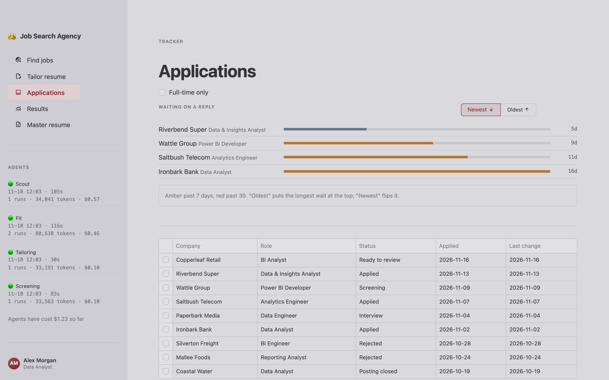
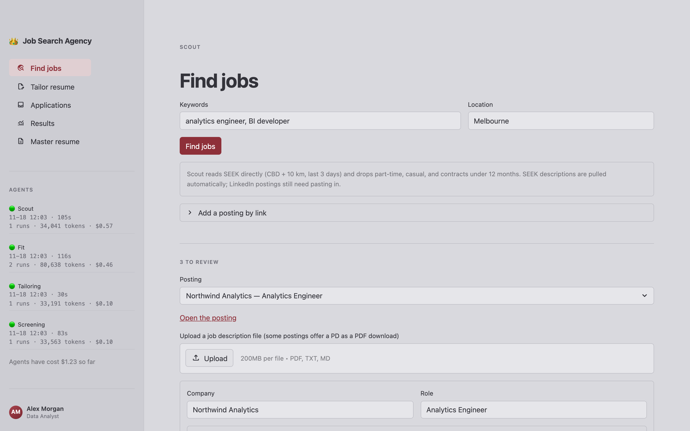
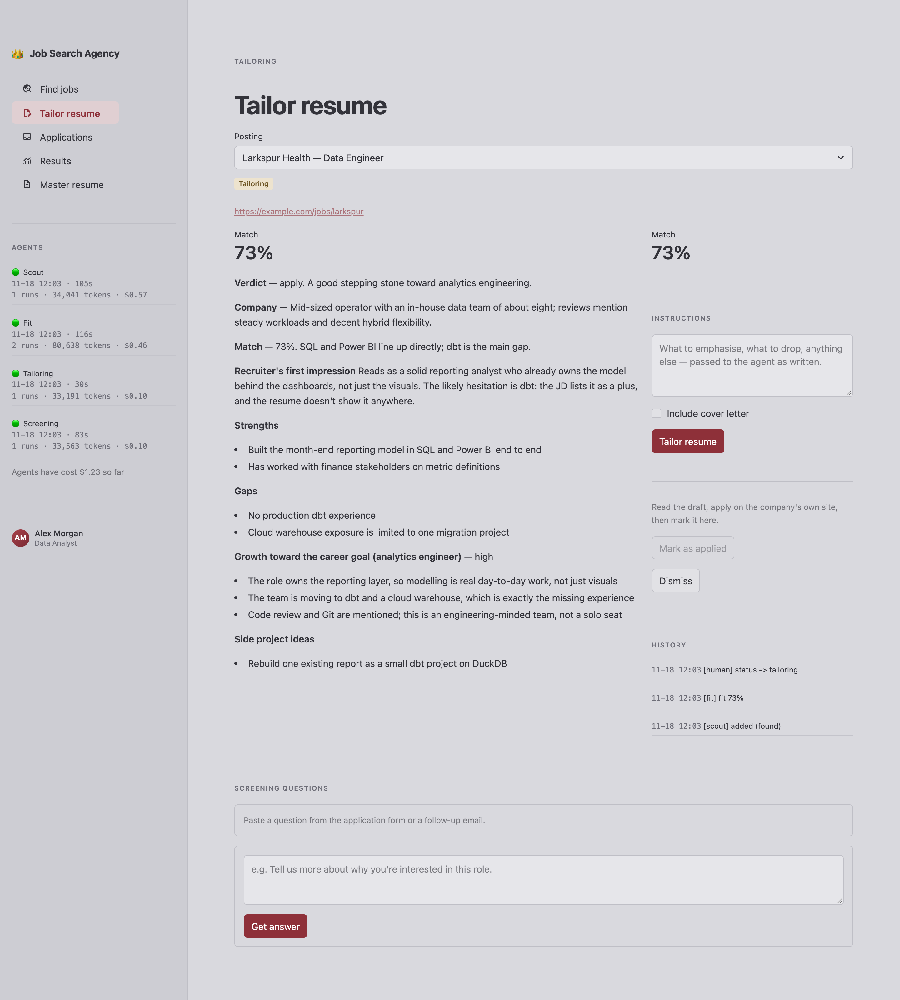
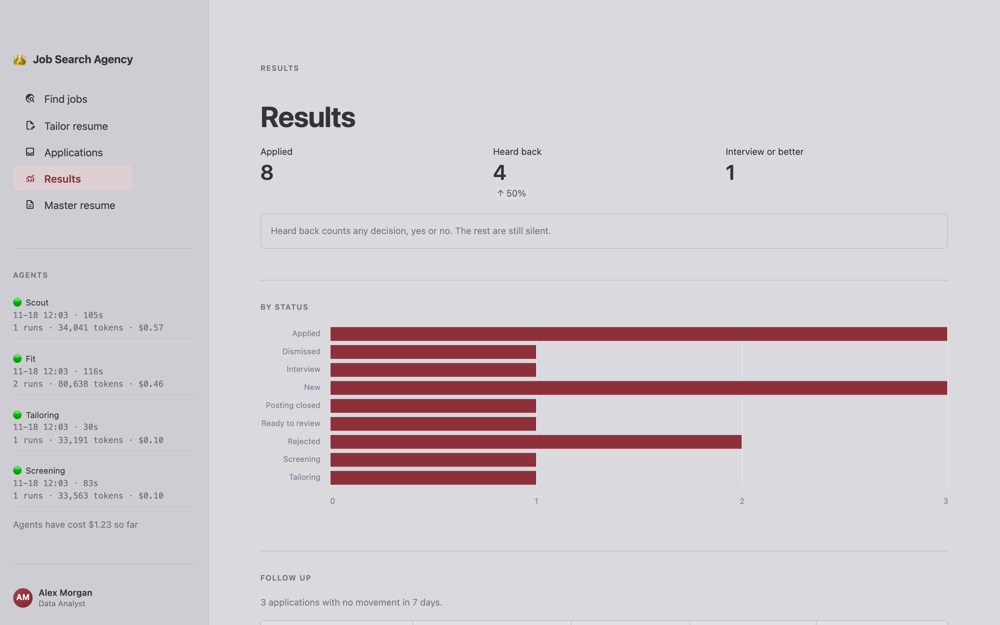

# Job Search Agency

A local dashboard that runs a small team of Claude Code agents over a job search: one finds
postings, one judges fit, one tailors the resume, one drafts screening answers. They hand
work to each other through a SQLite store. The human only steps in where something leaves
the system, like actually applying.



> Built for my own job search and published as a portfolio piece, for personal learning
> purposes. Every name, company and number in the screenshots is made-up demo data.

## How it works

```
 Streamlit dashboard ──(claude -p, background thread)──▶ agent
        ▲                                                 │
        │                                                 ▼
        └──────────── agency.db (SQLite) ◀──── python3 agency/agency.py <command>
```

- **Dashboard** (`agency/app.py`): Streamlit. Each button starts a headless Claude Code run
  (`claude -p --output-format json`) in a background thread with a narrow tool allowlist,
  so the page never blocks and an agent can only touch what it needs.
- **Store** (`agency/agency.py`): SQLite plus a small CLI. Agents never write SQL; every write
  goes through the CLI so it lands in an `events` log. It also records each run's duration,
  tokens and cost, which the sidebar shows.
- **Agents** (`.claude/agents/*.md`): Claude Code subagent definitions.

| Agent  | Does                                                                         | Never does                    |
|--------|------------------------------------------------------------------------------|-------------------------------|
| Scout  | Searches SEEK, drops senior / part-time / short-contract roles, adds the rest | Applies, fills forms           |
| Fit    | Scores the match, gives the recruiter's-eye view, and rates whether the role grows you toward your career goal | Decides to pursue the role     |
| Tailor | Writes a tailored resume (and cover letter) into `drafts/`                    | Submits anything               |
| Screen | Drafts a 150-word answer to an application-form question                      | Invents experience             |

Status moves `found → tailoring → awaiting_approval → applied → screening → interview →
offer / rejected`. The two decisions, *pursue this role* and *I applied*, are buttons the
human clicks. No agent can make them.

### What the fit check looks at

A match score alone answers "could I get this job?". The fit agent also answers "should I
want it?", so every diagnosis has:

- **Verdict** and **match %**, with the reasoning behind the number
- **Recruiter's first impression**: how the resume reads to someone screening for this
  role, including what would make them hesitate
- **Strengths** and **gaps** against the JD, taken only from the real master resume
- **Growth toward the career goal**: scored against the goal written in the master resume.
  It checks whether the role has hands-on modelling work or is pure reporting, whether it
  brings the tools the goal needs, and whether the team works in Git with code review.
  A role you'd get easily but that leads nowhere gets flagged as a title trap.
- **Side project ideas** to close the biggest gap

## Pages

| Find jobs | Tailor resume |
|---|---|
|  |  |

| Applications | Results |
|---|---|
|  |  |

## Run it

Needs Python 3 and [Claude Code](https://claude.com/claude-code) installed and logged in
(the agent buttons shell out to `claude`).

```bash
pip install -r requirements.txt
cp master-resume.example.md master-resume.md   # then replace it with your own
streamlit run agency/app.py
```

To look around without running any agents, load the demo data into a separate DB:

```bash
AGENCY_DB=agency/demo.db python3 agency/demo_data.py
AGENCY_DB=agency/demo.db streamlit run agency/app.py
```

Settings come from environment variables:

| Variable               | Default              |
|------------------------|----------------------|
| `AGENCY_DB`            | `agency/agency.db`   |
| `AGENCY_MASTER_RESUME` | `master-resume.md`   |
| `AGENCY_USER_NAME`     | `Alex Morgan`        |
| `AGENCY_USER_TITLE`    | `Data Analyst`       |

`python3 agency/agency.py` with no arguments runs the store's self-check.

## Limits

- `agency/seek.py` reads SEEK's public search pages directly. It's for personal use at a
  personal pace; check SEEK's terms before you point it at anything bigger.
- LinkedIn can't be read headlessly, so those postings get pasted in by hand.
- Single user, local only. There's no auth because nothing listens beyond localhost.

## Stack

Python, Streamlit, SQLite, Claude Code (headless subagents), pypdf.
